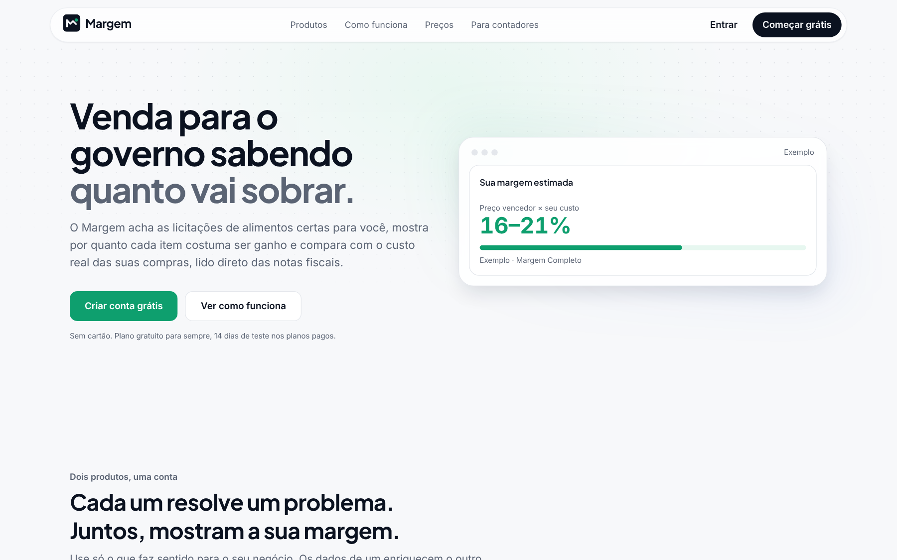

# Margem

> **Radar de licitações e painel de compras para pequenas empresas.**
> Projeto pessoal em desenvolvimento, publicado aqui como vitrine de código.




## A ideia

Dois produtos SaaS B2B sobre uma única conta, uma única API e um único design system:

|           | **Margem Licita**                                                   | **Margem Compras**                                            |
| --------- | ------------------------------------------------------------------- | ------------------------------------------------------------- |
| O que faz | Radar de licitações de alimentos, com o preço vencedor de cada item | Painel de custo de compra montado das NF-e recebidas          |
| Para quem | Fornecedores de alimentos para prefeituras e órgãos do Nordeste     | Mercadinhos, padarias, restaurantes e distribuidoras          |
| Fonte     | API pública de consulta do PNCP                                     | Distribuição DF-e da Receita, com o certificado A1 do cliente |
| Pergunta  | Onde tem licitação para mim e por quanto ela costuma ser ganha?     | Estou pagando caro? Qual fornecedor aumentou o preço?         |

Quem assina os dois vê a **margem estimada de cada licitação**, calculada com o próprio custo real de compra.

## Destaques técnicos

- **Monorepo** com Turborepo + pnpm: site, coletor e pacotes compartilhados (`core`, `ui`) num só lugar.
- **Segurança no banco, não só na tela:** Row Level Security em todas as tabelas, com **testes de RLS em Postgres rodando no CI** a cada PR ([`supabase/tests`](supabase/tests)).
- **Chave de serviço só no servidor:** o cliente recusa a service role e para de subir se ela aparecer onde não deve ([ADR 0004](docs/adr/0004-service-role-so-no-servidor.md)).
- **Certificado digital A1 guardado no Supabase Vault**, nunca em tabela comum ([ADR 0005](docs/adr/0005-certificado-a1-no-vault.md)).
- **LGPD desde o início:** CPF mascarado, política de retenção e exclusão de dados ([`docs/lgpd.md`](docs/lgpd.md)).
- **Coletor do PNCP** em TypeScript, que roda agendado no GitHub Actions ([`apps/coletor-pncp`](apps/coletor-pncp)).
- **Decisões de arquitetura documentadas** em 14 ADRs ([`docs/adr`](docs/adr)).
- **Qualidade automatizada:** lint, typecheck, testes unitários (Vitest), testes E2E (Playwright), CodeQL, Dependabot e commits padronizados (commitlint + Changesets).

## Estado atual

- ✅ Monorepo, CI e design system
- ✅ Landing responsiva
- ✅ Schema com três domínios (`core`, `licita`, `compras`) e RLS testada
- ✅ Coletor de licitações do PNCP
- ✅ Edge Function de upload do certificado A1
- 🚧 Login, onboarding, feed de licitações e importação de NF-e

<p align="center"></p>

## Estrutura

```
apps/
  web/             Next.js 15 (App Router)
  coletor-pncp/    job de coleta do PNCP, agendado no GitHub Actions
  mobile/          placeholder do app Expo (fase 2)
packages/
  core/            tipos do banco, cliente do PNCP, validações Zod, regras puras
  ui/              tokens do design system e componentes shadcn/ui (Radix)
supabase/
  migrations/      schema com RLS
  tests/           testes de RLS em Postgres puro
  functions/       Edge Functions (Deno)
docs/
  adr/             decisões de arquitetura
  lgpd.md          regras de LGPD do produto
```

## Rodar localmente

Requisitos: Node 22 (`.nvmrc`) e pnpm 10 (`corepack enable`).

```bash
pnpm install
pnpm dev                 # http://localhost:3000 — a landing abre sem Supabase
```

| Comando                                      | O que faz                                            |
| -------------------------------------------- | ---------------------------------------------------- |
| `pnpm lint` / `pnpm typecheck` / `pnpm test` | O mesmo que o CI roda                                |
| `pnpm build`                                 | Build de produção                                    |
| `pnpm test:e2e`                              | Playwright (depois de `pnpm build`)                  |
| `pnpm test:db`                               | Migrations + testes de RLS num Postgres local        |
| `COLETOR_SECO=1 pnpm coletar:pncp`           | Coleta o PNCP de verdade e só lista o que gravaria   |

> Esta é uma cópia de vitrine. Os workflows de deploy e de coleta agendada ficam só no repositório de produção, que tem as credenciais.

## Desenvolvimento assistido por IA

Este projeto é desenvolvido com apoio de IA (Claude e ChatGPT) para acelerar a implementação. Arquitetura, modelagem de dados, segurança e revisão do código ficam comigo.

## Autor

**Luis Campos** — Desenvolvedor Full Stack
[LinkedIn](https://www.linkedin.com/in/luis-campos-dev)

## Licença

Código disponível apenas para visualização. Todos os direitos reservados — veja [LICENSE](LICENSE).
